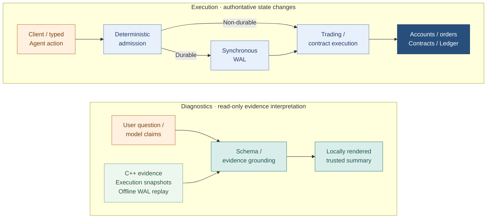

# Deterministic Agent Execution Runtime

[简体中文](README.md) | English

A C++20 deterministic execution system for account-backed trading, bilateral contracts, and internal settlement, with synchronous WAL durability and crash recovery. AI proposes typed actions and evidence-based diagnoses; deterministic mechanisms constrain both execution and factual claims.

**Untrusted AI can propose actions and explanations, but deterministic mechanisms decide what becomes authoritative or trusted.**

## Architecture



TCP I/O can be concurrent while authoritative mutations remain serial. Agents can also call the runtime directly, without TCP. Durable mode synchronizes the WAL before applying commands; diagnostics reads evidence separately and does not mutate authoritative state.

## Design Decisions

### Q1. Why handle network requests concurrently but serialize authoritative state changes?

A trade affects the order book, account reservations, and Ledger together. Interleaving those mutations would introduce more intermediate states and coordination across modules. The gateway therefore uses epoll for concurrent I/O, with bounded command and response queues connecting it to one execution thread and connection identities routing responses. Bounded queues limit backlog; an explicit command order makes state changes and replay easier to reason about.

Determinism applies to the same initial state and ordered commands, not an identical arrival order for concurrent requests. Direct Agent/runtime callers must also serialize execution. This gives authoritative state a clear execution order, making account consistency and crash recovery easier to reason about.

### Q2. How are trades, reserved funds, and settlement kept consistent?

Matching determines which orders trade, but cannot by itself ensure that their owners can pay. Account-backed execution first reserves quote assets for buys and base assets for sells, then performs financial preflight checks against the expected matches. Actual trades must agree with that plan before driving asset clearing and Ledger postings that balance per asset.

Partial fills retain reservations for the remainder; buy-side price improvements release excess funds. Cancellation checks ownership and releases only the remaining obligation. Bilateral contract settlement spends available quote without consuming order reservations, as covered by the [account execution tests](tests/accounting/execution_coordinator_test.cpp) and [contract settlement tests](tests/durability/durable_contract_execution_test.cpp).

Each account/asset balance keeps `available + reserved <= INT64_MAX`, including credits and transfers, so reserved funds remain releasable. An order whose settlement credits would exceed this range returns `INVALID_ORDER` before matching, preserving balances, reservations, orders, and Ledger. In durable mode this admitted command remains in the WAL and consumes an execution identity; recovery reproduces the rejection. Exact-boundary balances remain valid.

### Q3. What happens if a command is durable but the client never receives its response?

Durable mode appends and synchronizes the command before applying it, then returns a business response. The process may crash after execution but before delivery, or the connection may break in that window. Restart validates the log and replays valid history in order from matching bootstrap account state, reconstructing orders, balances, reservations, contracts, and the Ledger. A missing response therefore cannot establish non-execution; the [real process tests](tests/gateway/durable_server_process_test.cpp) exercise this window.

Journal acceptance is also distinct from business success: trading rejections such as insufficient funds can occur after journaling and recur during recovery. RequestId only correlates requests and responses; resubmitting it may create another order, with no general deduplication or exactly-once guarantee. Settled contracts reject another settlement to prevent double payment, but that protection is specific to their state machine.

Unexpected journal/application exceptions propagate and poison both trading and contract execution, including non-durable trading. Local insertion and pre-matching rollback do not provide global rollback after matching or event publication begins. A poisoned runtime must be discarded or recovered from its WAL before further execution. The WAL encoding is unchanged; histories containing the former balance-overflow defects replay with corrected financial rejection rules rather than reconstructing an unreleasable balance.

### Q4. How can AI propose trading actions without bypassing execution constraints?

Model output cannot authorize itself. The provider parses it into a closed set of typed actions; AgentRuntime checks structure and configured hard economic constraints. A host-side adapter then binds the account and acting identity from the registry, so action fields cannot substitute another execution account.

The execution path independently checks balances, cancellation ownership, contract permissions, and state transitions. Agent interfaces submit action requests; the execution layer modifies accounts, the order book, and Ledger. Economic profiles add admission constraints that TCP clients do not automatically inherit. The execution layer's business checks make the final admission decision.

### Q5. Why is valid model JSON not enough to trust an AI diagnosis?

Valid JSON establishes parseability, and schema validation alone cannot establish truth. The diagnostic runner grounds supported facts and causes against C++ execution evidence, then renders a trusted summary locally from validated fields. Even correct structured facts do not make arbitrary accompanying prose trustworthy. If an order is partially filled with its remainder resting, but the model writes “cancelled,” the local summary reports the verified resting state; contradictory structured facts instead cause rejection. The [diagnostic regression tests](diagnostics/python/tests/test_diagnostic_runner.py) check that provider prose cannot change the trusted summary.

Evidence also limits the questions that can be answered. Execution-time partial-fill evidence comes from a fixed real C++ scenario, not arbitrary historical contexts. The historical tool runs production recovery on a private copy of an offline WAL, with conclusions limited to the recovered prefix. It cannot prove original response delivery or recreate missing pre-execution matching context or arbitrary matching-stop causes. Equal OrderIds across independent tools do not identify the same execution.

### Q6. Why did the Ledger optimization improve throughput but barely affect durable performance?

Earlier profiling identified repeated relocation as Ledger history grew: reserving exactly the required capacity for successive small batches repeatedly moved existing records. The [implementation](src/accounting/ledger.cpp) now uses bounded geometric growth, reducing relocations at the cost of additional spare capacity. Allocation stays in prepare; commit remains allocation-free and `noexcept`, preserving accounting and WAL semantics.

Previously reported paired measurements showed **21,204 → 51,550 commands/s (approximately 2.43×)** for a four-client, 10,000-command non-durable gateway workload. A four-client, 2,000-command durable workload stayed at **250.32 → 250.28 commands/s**. Environment: GCC 13.4, Release `-O3`, WSL2 / i9-12900H. Reducing Ledger history relocations paid off in this non-durable workload, while per-command WAL synchronization remained the dominant cost in durable mode.

## Quick Start

On Linux / WSL2, use a C++20 compiler, CMake 3.20+, and the nlohmann-json CMake package. Building tests also requires GoogleTest (downloaded through CMake FetchContent if unavailable); the script's default mode disables tests. Disabling external providers does not remove the nlohmann-json dependency.

Without live models or external APIs, the [main demo](apps/exchange_runtime_demo/main.cpp) uses scripted actions and a real WAL to demonstrate trading, contract settlement, a process crash before response delivery, and exact recovery. Run from the repository root:

```bash
cmake -S . -B build -DCMAKE_BUILD_TYPE=Release -DEXCHANGE_BUILD_DEEPSEEK_PROVIDER=OFF -DEXCHANGE_BUILD_BINANCE_ALPHA_FEED=OFF
cmake --build build -j4
ctest --test-dir build --output-on-failure
./build/exchange_runtime_demo
```

Alternatively, run `./quickstart.sh` to build and launch the demo, or `./quickstart.sh test` to run the full C++ test suite.

This configuration disables optional external integrations; the main demo does not require live market data or a model API. Python diagnostics tests require Python 3.10+: `python3 -m unittest discover -s diagnostics/python/tests -v`. They make no live API calls by default and skip explicitly opt-in historical C++ integration tests.

## Scope and Limitations

The system runs authoritative state changes serially on a single node, with one instrument per runtime, internal account balances and settlement, and explicit durability, recovery, and AI integration boundaries. It provides no multi-node HA or general exactly-once execution, routes no real orders, and holds no assets in custody. It is not a production exchange or a general-purpose Agent orchestration platform.
