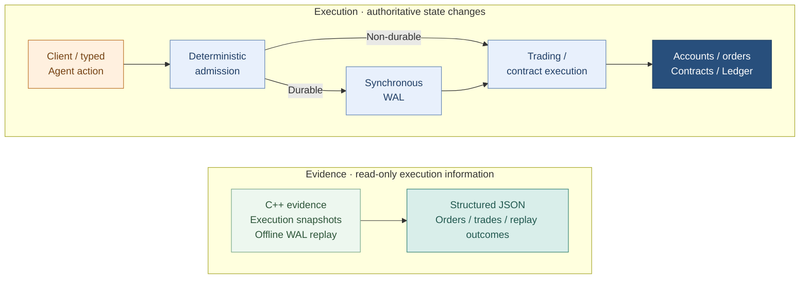

# Deterministic Agent Execution Runtime

[简体中文](README.md) | English

A C++20 deterministic execution system for account-backed trading, bilateral contracts, and internal settlement, with synchronous WAL durability and crash recovery. Scripted or rule-based agents propose typed actions, while C++ evidence tools export structured execution and recovery information.

**Agents propose actions, deterministic execution determines authoritative state, and C++ tools export execution and recovery evidence.**

## Architecture



TCP I/O can be concurrent while authoritative mutations remain serial. Agents can also call the runtime directly, without TCP. Durable mode synchronizes the WAL before applying commands. C++ evidence tools read execution information; historical queries recover a private copy of an offline WAL without modifying the source.

## Design Decisions

### Q1. Why handle network requests concurrently but serialize authoritative state changes?

A trade affects the order book, account reservations, and Ledger together. Interleaving those mutations would introduce more intermediate states and coordination across modules. The gateway therefore uses epoll for concurrent I/O, with bounded command and response queues connecting it to one execution thread and connection identities routing responses. Bounded queues limit backlog; an explicit command order makes state changes and replay easier to reason about.

Determinism applies to the same initial state and ordered commands, not an identical arrival order for concurrent requests. Direct Agent/runtime callers must also serialize execution. This gives authoritative state a clear execution order, making account consistency and crash recovery easier to reason about.

### Q2. How are trades, reserved funds, and settlement kept consistent?

Matching determines which orders trade, but cannot by itself ensure that their owners can pay. Account-backed execution first reserves quote assets for buys and base assets for sells, then performs financial preflight checks against the expected matches. Actual trades must agree with that plan before driving asset clearing and Ledger postings that balance per asset.

Partial fills retain reservations for the remainder; buy-side price improvements release excess funds. Cancellation checks ownership and releases only the remaining obligation. Bilateral contract settlement spends available quote without consuming order reservations, as covered by the [account execution tests](tests/accounting/execution_coordinator_test.cpp) and [contract settlement tests](tests/durability/durable_contract_execution_test.cpp).

Each account/asset balance keeps `available + reserved <= INT64_MAX`, including credits and transfers, so reserved funds remain releasable. An order whose settlement credits would exceed this range returns `INVALID_ORDER` before matching, preserving balances, reservations, orders, and Ledger. In durable mode this admitted command remains in the WAL and consumes an execution identity; recovery reproduces the rejection. Exact-boundary balances remain valid.

### Q3. What happens if a command is durable but the client never receives its response?

Durable mode appends and synchronizes the command before applying it, then returns a business response. The process may crash after execution but before delivery, or the connection may break in that window. Restart validates the log and replays valid history in order from matching bootstrap account state, reconstructing orders, balances, reservations, contracts, and the Ledger. A missing response therefore cannot establish non-execution; the [real process tests](tests/gateway/durable_server_process_test.cpp) exercise this window.

Journal acceptance is also distinct from business success: trading rejections such as insufficient funds can occur after journaling and recur during recovery. RequestId only correlates requests and responses; resubmitting it may create another order, with no general deduplication or exactly-once guarantee. Settled contracts reject another settlement to prevent double payment, but that protection is specific to their state machine.

Unexpected journal/application exceptions propagate and poison both trading and contract execution, including non-durable trading. Local insertion and pre-matching rollback do not provide global rollback after matching or event publication begins. A poisoned runtime must be discarded or recovered from its WAL before further execution. The WAL encoding is unchanged; histories containing the former balance-overflow defects replay with corrected financial rejection rules rather than reconstructing an unreleasable balance.

### Q4. How are agent trading actions constrained by the execution path?

`AgentDecisionProvider` returns a closed set of typed actions; scripted and rule-based strategies remain available. AgentRuntime checks structure and configured hard economic constraints. A host-side adapter then binds the account and acting identity from the registry, so action fields cannot substitute another execution account.

The execution path independently checks balances, cancellation ownership, contract permissions, and state transitions. Agent interfaces submit action requests; the execution layer modifies accounts, the order book, and Ledger. Economic profiles add admission constraints that TCP clients do not automatically inherit. The execution layer's business checks make the final admission decision.

### Q5. What can the C++ evidence tools establish?

The [partial-fill tool](apps/exchange_diagnostic_evidence/main.cpp) exports structured execution evidence from a fixed C++ scenario. The [historical order tool](apps/exchange_historical_order_evidence/main.cpp) runs production recovery on a private copy of an offline WAL, exporting orders, trades, reservations, and recomputed business outcomes. Neither tool calls a model or generates AI diagnoses; the [C++ evidence tests](tests/diagnostics/) cover their behavior.

Historical evidence is limited to the recovered prefix. It cannot prove original response delivery or recreate missing pre-execution matching context or arbitrary matching-stop causes. Equal OrderIds across independent tools do not identify the same execution.

### Q6. Why did the Ledger optimization improve throughput but barely affect durable performance?

Earlier profiling identified repeated relocation as Ledger history grew: reserving exactly the required capacity for successive small batches repeatedly moved existing records. The [implementation](src/accounting/ledger.cpp) now uses bounded geometric growth, reducing relocations at the cost of additional spare capacity. Allocation stays in prepare; commit remains allocation-free and `noexcept`, preserving accounting and WAL semantics.

Previously reported paired measurements showed **21,204 → 51,550 commands/s (approximately 2.43×)** for a four-client, 10,000-command non-durable gateway workload. A four-client, 2,000-command durable workload stayed at **250.32 → 250.28 commands/s**. Environment: GCC 13.4, Release `-O3`, WSL2 / i9-12900H. Reducing Ledger history relocations paid off in this non-durable workload, while per-command WAL synchronization remained the dominant cost in durable mode.

## Quick Start

The default Linux / WSL2 build needs a C++20 compiler and CMake 3.20+. Building tests also requires GoogleTest (downloaded through CMake FetchContent if unavailable); the script's default mode disables tests. `EXCHANGE_BUILD_EVIDENCE` defaults to `OFF`: the default build does not discover or depend on nlohmann-json, and does not require libcurl, OpenSSL, or Boost.

Without live models or external APIs, the [main demo](apps/exchange_runtime_demo/main.cpp) uses scripted actions and a real WAL to demonstrate trading, contract settlement, a process crash before response delivery, and exact recovery. Run from the repository root:

```bash
cmake -S . -B build-core -DCMAKE_BUILD_TYPE=Release
cmake --build build-core -j4
ctest --test-dir build-core --output-on-failure
./build-core/exchange_runtime_demo
```

Alternatively, run `./quickstart.sh` to build and launch the demo, or `./quickstart.sh test` to run the full core C++ test suite; the script explicitly disables Evidence.

The main demo uses local scripts and calls no market-data or model API. To build the C++ evidence tools on Linux / WSL2, install the nlohmann-json CMake package and enable them in a separate directory:

```bash
cmake -S . -B build-evidence -DCMAKE_BUILD_TYPE=Release -DEXCHANGE_BUILD_EVIDENCE=ON
cmake --build build-evidence -j4
ctest --test-dir build-evidence --output-on-failure
./build-evidence/exchange_runtime_demo
./build-evidence/exchange_diagnostic_evidence
```

This configuration adds both evidence libraries, the partial-fill and historical-order CLIs, and their specific tests; all core tests remain enabled. Process integration tests exercise the historical CLI against offline WALs. For applications only, also pass `-DEXCHANGE_BUILD_TESTS=OFF`; GoogleTest is then unnecessary.

## Scope and Limitations

The system runs authoritative state changes serially on a single node, with one instrument per runtime, internal account balances and settlement, explicit durability and recovery boundaries, typed Agent interfaces, and structured execution evidence. It provides no multi-node HA or general exactly-once execution, routes no real orders, and holds no assets in custody. It is not a production exchange or a general-purpose Agent orchestration platform.
