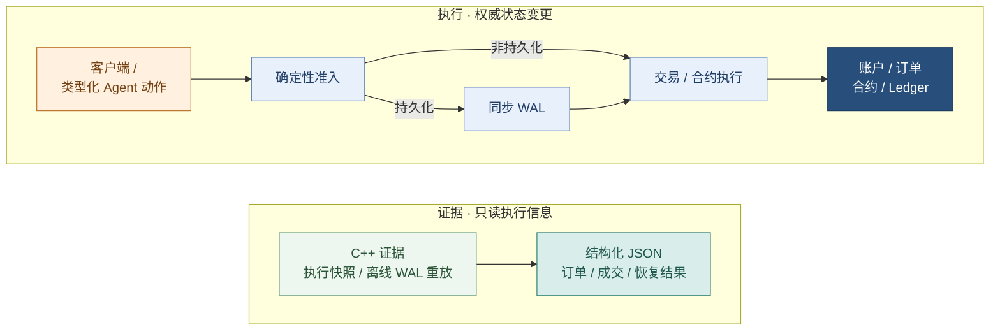

# Deterministic Agent Execution Runtime

简体中文 | [English](README-EN.md)

一个使用 C++20 构建的确定性交易与 Agent 执行系统，支持账户交易、双边合约和内部结算，通过同步 WAL 与崩溃恢复重建权威状态。脚本或规则 Agent 提出类型化动作，C++ 证据工具导出结构化的执行与恢复信息。

**Agent 提出动作，确定性执行路径决定权威状态；C++ 工具导出执行与恢复证据。**

## 架构



TCP I/O 可以并发，权威状态修改保持串行；Agent 也可以直接调用 runtime，不必经过 TCP。持久化模式在应用命令前完成 WAL 同步。C++ 证据工具读取执行信息；历史查询在离线 WAL 的私有副本上恢复，不修改源 WAL。

## 设计取舍

### Q1. 为什么并发处理网络请求，却串行执行状态变更？

一笔交易同时涉及订单簿、账户预留和 Ledger；让这些修改交错执行，会增加中间状态和跨模块协调的复杂度。因此 gateway 用 epoll 处理并发 I/O，通过有界命令和响应队列连接单个执行线程，并按连接身份路由响应。有界队列限制积压，明确的命令顺序则让状态变化与重放更容易推理。

确定性针对相同初始状态和有序命令，不保证并发请求每次以相同顺序到达。直接调用 Agent/runtime 接口也必须遵守串行执行约定。这让权威状态拥有明确的执行顺序，使账户一致性和故障恢复更容易推理。

### Q2. 如何保证成交、资金预留与结算结果一致？

撮合引擎能决定谁与谁成交，却不能独自保证账户有钱履约。账户执行路径先为买单预留报价资产、为卖单预留基础资产，再通过财务预检查核对预计成交的资金需求。撮合返回后，实际 trades 必须与计划一致，随后驱动资产清算和按资产平衡的 Ledger 记账。

部分成交保留未完成部分的预留；买单获得价格改善时释放多余预留；撤单验证所有权，只释放剩余义务。双边合约结算则只转移可用报价资产，不能花掉订单已经预留的资金；这些行为由[账户执行测试](tests/accounting/execution_coordinator_test.cpp)和[合约结算测试](tests/durability/durable_contract_execution_test.cpp)覆盖。

每个账户、每种资产都保持 `available + reserved <= INT64_MAX`，入账和转账也计入已有预留，从而保证预留资金可以释放。结算入账会超出此范围的订单在撮合前返回 `INVALID_ORDER`，余额、预留、订单簿和 Ledger 保持不变。持久化模式仍记录这条已准入命令并消耗执行身份，恢复时重现相同拒绝；恰好达到上限的合法余额仍可使用。

### Q3. 如果命令已持久化，但客户端没有收到响应，会发生什么？

持久化模式先追加命令并同步 WAL，再应用状态变更，然后返回业务响应。进程可能在执行后、响应送达前崩溃，连接也可能在这个窗口断开。重启会校验日志，并从匹配的初始账户配置按顺序重放有效历史，重建订单、余额、预留、合约和 Ledger。因此，客户端没有收到响应，不能推断命令未执行；[真实进程测试](tests/gateway/durable_server_process_test.cpp)覆盖了这一窗口。

WAL 接收也不等于业务成功：资金不足等交易拒绝可能发生在写入之后，并在恢复时重现。RequestId 仅用于关联，相同值再次提交仍可能创建新订单，没有通用去重或 exactly-once 保证。已结算合约会拒绝再次结算以防止重复付款，这是合约状态机的局部保护。

意外的 journal/application 异常会原样传播，并使交易和合约执行共同进入 poisoned 状态，非持久化交易也遵守这一边界。局部插入回滚和撮合前回滚不代表撮合或事件发布开始后的全局回滚；后续执行必须丢弃该 runtime，或从 WAL 创建恢复实例。WAL 编码没有改变；包含旧余额溢出缺陷的历史按修正后的财务规则重放为业务拒绝，不再重建无法释放预留的余额。

### Q4. Agent 提出的交易动作如何受到执行约束？

`AgentDecisionProvider` 返回封闭的类型化动作集合；当前保留脚本和规则策略。AgentRuntime 检查结构和配置的硬经济约束，再由宿主侧 adapter 从注册表绑定账户与行动者身份。动作字段不能将请求切换到其他执行账户。

动作随后进入实际执行路径，继续检查余额、撤单所有权、合约参与权限和状态转换。Agent 接口只提交动作请求，账户、订单簿和 Ledger 由执行层修改。经济 profile 提供额外的准入约束，TCP 客户端不会自动继承它；最终是否执行由执行层的业务检查决定。

### Q5. C++ 证据工具能说明什么？

[partial-fill 工具](apps/exchange_diagnostic_evidence/main.cpp)导出固定 C++ 场景的结构化执行证据；[历史订单工具](apps/exchange_historical_order_evidence/main.cpp)在离线 WAL 的私有副本上运行生产恢复，导出订单、成交、预留和重算的业务结果。两者均不调用模型或生成 AI 诊断，相关行为由 [C++ evidence 测试](tests/diagnostics/)覆盖。

历史证据限于恢复前缀，不能证明原始响应送达，也不能补出缺失的执行前撮合上下文或任意停止撮合原因。两个独立工具中相同的 OrderId 不代表同一次执行。

### Q6. 为什么优化了 Ledger，持久化吞吐却几乎没有变化？

此前 profiling 将开销定位到 Ledger 历史增长中的反复搬移：小批次不断精确预留所需容量，会频繁复制或移动已有记录。[实现](src/accounting/ledger.cpp)改为有上限的几何扩容，减少搬移次数，代价是额外空余容量。分配仍发生在 prepare 阶段，commit 保持无分配且 `noexcept`，记账和 WAL 语义未改变。

既有同环境配对测量中，4 客户端、10,000 条命令的非持久化 gateway 吞吐从 **21,204 → 51,550 commands/s（约 2.43×）**；4 客户端、2,000 条命令的持久化吞吐则为 **250.32 → 250.28 commands/s**。环境为 GCC 13.4、Release `-O3`、WSL2 / i9-12900H。在上述非持久化负载中，减少 Ledger 历史搬移带来了明显收益；持久化负载则仍由逐命令 WAL 同步主导。

## 快速开始

Linux / WSL2 的默认构建需要 C++20 编译器和 CMake 3.20+。构建测试时还需 GoogleTest（未安装时 CMake 通过 FetchContent 下载）；脚本默认模式关闭测试。`EXCHANGE_BUILD_EVIDENCE` 默认 `OFF`，默认构建不查找或依赖 nlohmann-json，也不需要 libcurl、OpenSSL 或 Boost。

无需实时模型或外部 API，[主 demo](apps/exchange_runtime_demo/main.cpp)使用脚本动作和真实 WAL，展示交易、合约结算、响应交付前的进程崩溃与精确恢复。在仓库根目录运行：

```bash
cmake -S . -B build-core -DCMAKE_BUILD_TYPE=Release
cmake --build build-core -j4
ctest --test-dir build-core --output-on-failure
./build-core/exchange_runtime_demo
```

也可运行 `./quickstart.sh` 构建并演示，或使用 `./quickstart.sh test` 运行完整核心 C++ 测试；脚本显式关闭 Evidence。

主 demo 使用本地脚本，不调用行情或模型 API。需要 C++ 证据工具时，在 Linux / WSL2 安装 nlohmann-json CMake package，并在独立目录中显式开启：

```bash
cmake -S . -B build-evidence -DCMAKE_BUILD_TYPE=Release -DEXCHANGE_BUILD_EVIDENCE=ON
cmake --build build-evidence -j4
ctest --test-dir build-evidence --output-on-failure
./build-evidence/exchange_runtime_demo
./build-evidence/exchange_diagnostic_evidence
```

此配置增加两个证据库、partial-fill 与 historical-order CLI，以及专属测试；核心测试仍全部保留。历史 CLI 的离线 WAL 查询由进程集成测试覆盖。仅构建应用时可追加 `-DEXCHANGE_BUILD_TESTS=OFF`，不需要 GoogleTest。

## 范围与限制

系统在单节点上串行执行权威状态变更，每个 runtime 对应一个交易品种，使用内部账户余额和结算，提供明确的持久化、恢复、类型化 Agent 接口和结构化执行证据。项目不提供多节点 HA 或通用 exactly-once，不路由真实订单、不托管资产，也不是生产交易所或通用 Agent 编排平台。
